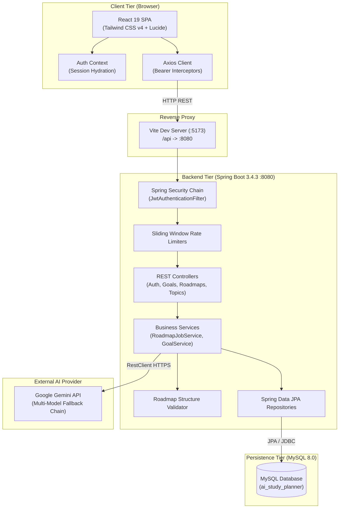
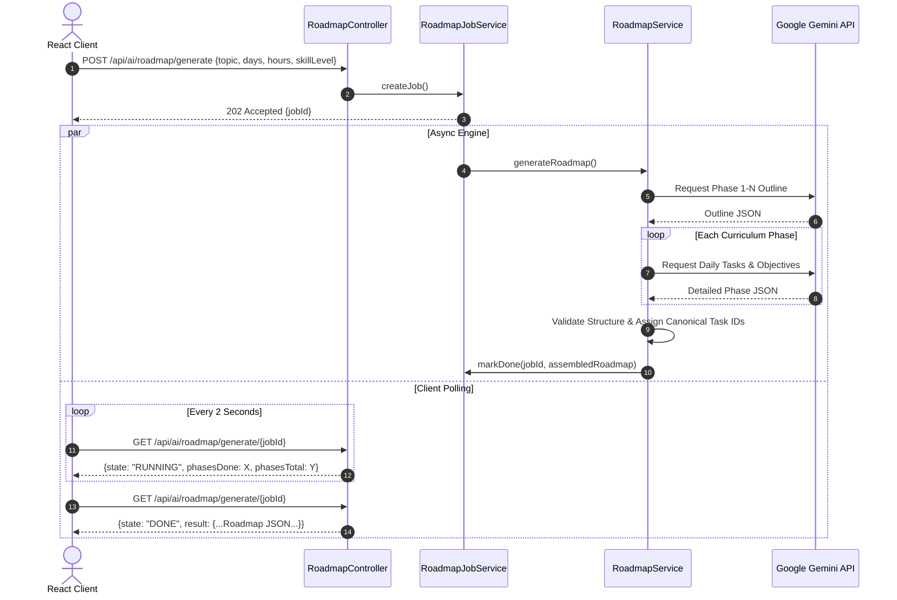

# AI Study Planner — Personalized Learning Roadmap Generator

[](https://github.com/ChetanYadav06/AI-Study-Planner/actions/workflows/ci.yml)
[](https://spring.io/projects/spring-boot)
[](https://www.oracle.com/java/)
[](https://react.dev/)
[](https://tailwindcss.com/)
[](https://www.mysql.com/)
[](https://ai.google.dev/)

An intelligent full-stack EdTech web application that synthesizes custom, day-by-day learning roadmaps, schedules daily study activities, provides on-demand topic deep dives, and tracks student progress using Google Gemini AI and Spring Boot.

---

## 📖 Table of Contents
- [Project Overview](#-project-overview)
- [Key Features](#-key-features)
- [Application Screenshots](#-application-screenshots)
- [Technology Stack](#-technology-stack)
- [System Architecture](#-system-architecture)
- [Repository Structure](#-repository-structure)
- [Database Overview](#-database-overview)
- [Security & Authentication](#-security--authentication)
- [AI Engine & Generation Pipeline](#-ai-engine--generation-pipeline)
- [REST API Summary](#-rest-api-summary)
- [Getting Started](#-getting-started)
  - [Prerequisites](#prerequisites)
  - [Environment Configuration](#environment-configuration)
  - [One-Command Quickstart](#one-command-quickstart)
  - [Manual Execution](#manual-execution)
- [Testing & Quality Assurance](#-testing--quality-assurance)
- [Development Status](#-development-status)
- [Future Enhancements](#-future-enhancements)
- [Contributing](#-contributing)
- [License](#-license)

---

## 🌟 Project Overview

Traditional curriculum planning often overwhelms learners with generic, unstructured course outlines. **AI Study Planner** solves this by evaluating a student's prior knowledge, target timeframe, available daily study hours, and preferred learning formats to synthesize an adaptive, day-by-day study roadmap.

Each generated curriculum organizes learning into sequential phases, milestones, canonical daily tasks, hands-on practice exercises, comprehension quizzes, and verified external learning resources. Students can actively log focus sessions with a Pomodoro timer, mark tasks complete, rate lesson difficulty, and generate on-demand technical deep dives for complex topics.

---

## 🚀 Key Features

### 1. Reliable AI Curriculum Generation
- **Asynchronous Generation Engine:** Uses background worker threads with job-status polling (`QUEUED`, `RUNNING`, `DONE`, `FAILED`) to generate multi-week curriculums without client timeout errors.
- **Multi-Model Fallback Chain:** Automatically fails over between `gemini-3.5-flash-lite`, `gemini-2.5-flash`, and `gemini-flash-lite-latest` on rate limits or API transient faults.
- **Two-Pass Generation:** Generates high-level curriculum outline first, followed by granular per-phase daily schedules, ensuring structured depth and preventing repetition.
- **Strict Schema Validation:** Automated structural and semantic validator checks canonical task IDs, duration caps, and mandatory learning objectives.

### 2. Interactive Roadmap & Daily Timetable
- **Phase & Timeline Views:** Expandable curriculum phases with daily breakdown, estimated minutes, activity types, and milestones.
- **Task Completion Sync:** Single canonical progress metric calculated from completed task IDs stored in MySQL.
- **Topic Expansions:** On-demand AI tutorial generator that provides detailed, step-by-step markdown explanations for any roadmap topic.
- **Supplementary Topics:** Allows adding extra custom topics to any schedule day without corrupting the base roadmap schema.
- **Task Feedback System:** Students can rate daily tasks (`TOO_EASY`, `JUST_RIGHT`, `TOO_HARD`) to calibrate difficulty.

### 3. Student Personalization & Knowledge Base
- **Topic Competency Matrix:** Interactive tracking of student competency across topics (`NOT_LEARNED`, `BEGINNER`, `INTERMEDIATE`, `MASTERED`).
- **Learning Preferences Calibration:** Fine-tune study pace (Relaxed, Balanced, Intensive), preferred formats (Videos, Reading, Coding Practice), explanation style (Step-by-step, Simple, Technical), and daily study durations.
- **AI Personalization Injection:** Automatically feeds competency matrices and preferences into the Gemini prompt pipeline.

### 4. Goals Management & Focus Sessions
- **Target Tracking:** Create goals with target days, hours per day, priority, and skill level.
- **Focus Timer:** Built-in Pomodoro and focus session tracker logging timestamps and durations to MySQL.
- **Streak & Analytics:** Real-time dashboard calculating study streaks, total focus hours, and completion rates.

### 5. Enterprise-Grade Security & Isolation
- **Stateless JWT Bearer Auth:** Secure user registration and login using HMAC-SHA512 signed tokens.
- **Database Multi-Tenancy:** Hardened tenant isolation queries ensuring students cannot view, modify, or delete another student's goals or roadmaps.
- **Rate Limiting:** Sliding-window defense against authentication brute-force, AI generation abuse, and link verification flooding.

---

## 📸 Application Screenshots

> *Screenshots can be added to [`docs/screenshots/`](docs/screenshots/) to display live previews.*

| Student Dashboard | Interactive Roadmap |
|:---:|:---:|
|  |  |
| *Real-time statistics, active goals, study streak* | *Day-by-day learning schedule and task checkboxes* |

| Topics & Knowledge Calibration | Learning Preferences |
|:---:|:---:|
|  |  |
| *Competency management and search filters* | *Interactive format, pace, and explanation selectors* |

---

## 🛠️ Technology Stack

### Frontend
- **Framework:** React 19.3.0
- **Language:** JavaScript (JSX)
- **Build System:** Vite 8.3.0 (`@vitejs/plugin-react`)
- **Styling:** Tailwind CSS 4.3.3 (`@tailwindcss/vite`)
- **Icons:** Lucide React (1.52.0)
- **Data Visualization:** Recharts (3.10.1)
- **HTTP Client:** Axios (1.20.0) with custom request/response interceptors

### Backend
- **Framework:** Spring Boot 3.4.3
- **Language:** Java 24 (compatible with OpenJDK 17/21/24)
- **Security:** Spring Security 6.4 + JJWT 0.12.6 (HS512 stateless tokens)
- **Persistence:** Spring Data JPA + Hibernate ORM 6.6
- **Database Driver:** MySQL Connector/J 9.2.0
- **Connection Pool:** HikariCP
- **Validation:** Jakarta Bean Validation (`@Valid`, Hibernate Validator)
- **Testing:** JUnit 5, Mockito, Spring Boot Test, Spring Security Test

### Database
- **Engine:** MySQL 8.0 (InnoDB)
- **Schema Management:** Hibernate automatic schema update (`ddl-auto=update`) + versioned manual migration scripts (`/scripts`)

### Artificial Intelligence
- **Platform:** Google Gemini API
- **Model Fallback Chain:** `gemini-3.5-flash-lite` → `gemini-2.5-flash` → `gemini-flash-lite-latest`
- **Output Enforcement:** Native JSON Mode schema prompting and Java structural validation

---

## 🏛️ System Architecture



For in-depth architectural specifications and sequence diagrams, refer to [**docs/architecture.md**](docs/architecture.md).

---

## 📁 Repository Structure

```
AI-Study-Planner/
├── .agent/workflows/       # Agentic automation workflows
├── .agents/                # Project agents and specialized skills
├── .gemini/                # Gemini model configuration and integration rules
├── .github/workflows/      # GitHub Actions CI workflow (ci.yml)
├── .gsd/                   # GSD development templates and reference specifications
├── .vscode/                # IDE editor settings
├── adapters/               # Model-specific integration adapters
├── backend/                # Spring Boot 3.4.3 Java backend
│   ├── src/main/java/      # REST API source code (controllers, entities, services)
│   ├── src/main/resources/ # application.properties (CORS, Datasource, JWT)
│   ├── src/test/           # Comprehensive JUnit 5 & Mockito test suite
│   ├── pom.xml             # Maven build configuration
│   └── README.md           # Backend technical documentation
├── frontend/               # React 19 + Tailwind v4 Vite application
│   ├── public/             # Static assets and icons
│   ├── src/                # React components, context, and styles
│   ├── index.html          # SPA entry point
│   ├── package.json        # Frontend dependencies
│   └── vite.config.js      # Vite build and proxy settings
├── docs/                   # Architectural & technical documentation
│   ├── architecture.md     # Component architecture and sequence flows
│   ├── database-schema.md  # Entity definitions and Mermaid ER diagram
│   ├── api-documentation.md# Complete REST API specification
│   └── screenshots/        # Application interface previews
├── scripts/                # Database migrations, test runners, and search scripts
│   ├── *.sql               # Numbered, idempotent SQL migration scripts
│   ├── start-mysql.ps1     # Starts local MySQL daemon
│   ├── stop-mysql.ps1      # Gracefully stops MySQL daemon
│   └── README.md           # Script directory documentation
├── .env.example            # Environment variables configuration template
├── .gitignore              # Repository git ignore configuration
├── CONTRIBUTING.md         # Developer contribution guidelines
├── GSD-STYLE.md            # Coding conventions and methodology
├── PROJECT_RULES.md        # Canonical repository development rules
├── README.md               # Main project documentation (this file)
├── VERSION                 # Current release version tag
├── dev.ps1                 # ⚡ One-command full-stack launcher
├── package.json            # Monorepo root npm helper scripts
└── stop.ps1                # 🛑 One-command shutdown script
```

---

## 🗄️ Database Overview

The relational schema consists of 10 primary tables managed by Spring Data JPA and Hibernate:

| Table | Purpose |
|---|---|
| `users` | Student accounts, emails, and hashed credentials |
| `goals` | Long-term and short-term study targets with progress tracking |
| `saved_roadmaps` | Generated curriculums stored as structured JSON payloads |
| `student_profiles` | Personal learning preferences (pace, duration, explanation style) |
| `student_topic_knowledge` | Student competency ratings per topic (`MASTERED`, `BEGINNER`, etc.) |
| `study_sessions` | Focus intervals and Pomodoro timer logs |
| `task_feedbacks` | Difficulty ratings for daily schedule tasks |
| `topic_expansions` | On-demand tutorial markdown deep dives |
| `day_extra_topics` | Supplementary topics attached to specific roadmap days |
| `resource_link_checks` | Global cache for verified external documentation links |

For column definitions, constraints, and the complete ER diagram, see [**docs/database-schema.md**](docs/database-schema.md).

---

## 🔐 Security & Authentication

- **Stateless Bearer Tokens:** Authentication is entirely stateless using JWT tokens signed via HMAC-SHA512.
- **Strict Environment Secrets:** Secrets are loaded via `${JWT_SECRET}`. The application fails to boot if missing or under 32 bytes.
- **Frontend Key Isolation:** The Google Gemini API key (`${GEMINI_API_KEY}`) is exclusively injected into the backend and is never sent to the browser.
- **Cross-User Isolation:** Every protected API endpoint enforces tenant isolation at the database query level (`findByIdAndUserId`).
- **Defensive Rate Limiting:**
  - Login attempts: 5 per 15 minutes per IP/email.
  - AI Roadmap Generation: 5 requests per hour per authenticated student.
  - Resource Link Validation: 10 requests per 5 minutes.

---

## 🤖 AI Engine & Generation Pipeline

Curriculum roadmap generation leverages Google Gemini models through an asynchronous job pipeline:



---

## 📡 REST API Summary

| Module | Method | Endpoint | Description |
|---|---|---|---|
| **Auth** | `POST` | `/api/auth/register` | Register new student account |
| **Auth** | `POST` | `/api/auth/login` | Authenticate student and obtain JWT |
| **Profile** | `GET` | `/api/profile` | Retrieve student personalization preferences |
| **Profile** | `PUT` | `/api/profile` | Update learning preferences & style |
| **Goals** | `GET` | `/api/goals` | List student learning goals |
| **Goals** | `POST` | `/api/goals` | Create a new learning goal |
| **Goals** | `PATCH` | `/api/goals/{id}/status` | Update goal status and progress |
| **Goals** | `DELETE` | `/api/goals/{id}` | Delete a learning goal |
| **AI Roadmap**| `POST` | `/api/ai/roadmap/generate` | Asynchronously initiate curriculum generation |
| **AI Roadmap**| `GET` | `/api/ai/roadmap/generate/{jobId}` | Poll generation job state and progress |
| **Roadmaps** | `GET` | `/api/roadmaps` | List saved curriculums |
| **Roadmaps** | `POST` | `/api/roadmaps` | Save generated curriculum to database |
| **Roadmaps** | `PATCH` | `/api/roadmaps/{id}/progress` | Synchronize completed task IDs |
| **Topics** | `POST` | `/api/roadmaps/{id}/days/{day}/topics/expand` | Generate on-demand markdown deep dive |
| **Topics** | `POST` | `/api/roadmaps/{id}/days/{day}/topics/extra` | Add supplementary topic to schedule day |
| **Sessions** | `POST` | `/api/study-sessions` | Log completed focus session |
| **Sessions** | `GET` | `/api/study-sessions/stats` | Retrieve focus hours and streak analytics |
| **Health** | `GET` | `/api/health` | Check backend & MySQL connectivity status |

For comprehensive parameter schemas and sample payloads, refer to [**docs/api-documentation.md**](docs/api-documentation.md).

---

## 🚀 Getting Started

### Prerequisites
- **Java:** JDK 24 (or JDK 17 / 21 LTS)
- **Maven:** Version 3.8+
- **Node.js:** Version 20+ or 22+ (npm 10+)
- **MySQL:** Server 8.0+ running on port `3306`

### Environment Configuration
Copy `.env.example` to `.env` in the repository root:
```bash
cp .env.example .env
```

Configure your environment variables:
```env
# Minimum 32-byte secret key for signing JWT tokens
JWT_SECRET=your-minimum-32-byte-secret-key-here-for-local-dev-change-for-prod

# Optional: Google Gemini API Key for AI generation
GEMINI_API_KEY=your-gemini-api-key-here

# Optional: MySQL password if set on your root user
DB_PASSWORD=
```

### One-Command Quickstart
For Windows PowerShell environments, use the built-in launcher to initialize MySQL, start the Spring Boot backend, and start the Vite frontend in one step:

```powershell
.\dev.ps1
```

*(If MySQL is already running as a Windows service, append `-SkipMysql`: `.\dev.ps1 -SkipMysql`)*

To gracefully stop all services:
```powershell
.\stop.ps1
```

Or using root npm shortcuts:
```powershell
npm run dev     # Launch all services
npm run stop    # Shut down all services
```

### Manual Execution

#### 1. Start MySQL Server
Ensure MySQL is running on port 3306 and that the development and test databases exist:
```sql
CREATE DATABASE IF NOT EXISTS ai_study_planner;
CREATE DATABASE IF NOT EXISTS ai_study_planner_test;
```

#### 2. Start Backend
```powershell
cd backend
mvn spring-boot:run
```
Backend runs at `http://localhost:8080`.

#### 3. Start Frontend
```powershell
cd frontend
npm install
npm run dev
```
Frontend runs at `http://localhost:5173`.

---

## 🧪 Testing & Quality Assurance

The repository includes a comprehensive automated test suite featuring unit tests, service mocks, rate limiter tests, and cross-user data isolation integration tests.

### Run Backend Tests
Tests execute against the isolated `ai_study_planner_test` database:
```powershell
mvn -f backend/pom.xml test
```
*Current test suite status: **108 tests passing, 0 failures, 0 errors**.*

### Run Frontend Production Build
```powershell
npm --prefix frontend run build
```
*Vite compiles and bundles modules cleanly with zero syntax or bundling errors.*

---

## 📊 Development Status

| Feature / Phase | Description | Status |
|---|---|:---:|
| **Phase 1** | Monorepo scaffolding, Spring Boot 3.4.3, React 19, MySQL 8.0 connectivity, health probe | ✅ Completed |
| **Phase 2** | JWT stateless authentication, BCrypt password hashing, session hydration | ✅ Completed |
| **Phase 3** | Student Dashboard, Goal Management, streak and study time metrics | ✅ Completed |
| **Phase 4** | Minimalist SaaS Design System, UI primitives, token-based Tailwind styling | ✅ Completed |
| **Phase 5** | Rate limiters, task difficulty feedback, resource link verification, hardening | ✅ Completed |
| **Phase 6** | Student Profile calibration, Topic Knowledge competency matrix | ✅ Completed |
| **Phase 7** | Async roadmap generation jobs, multi-model fallback chain, on-demand topic expansions | ✅ Completed |

---

## 🔮 Future Enhancements
- [ ] Export roadmaps to Google Calendar and iCal formats (.ics).
- [ ] Multi-lingual roadmap generation (Spanish, French, Hindi, German).
- [ ] Real-time study group collaboration and peer roadmaps sharing.
- [ ] Native mobile companion application (React Native / Expo).

---

## 🤝 Contributing

Contributions, bug reports, and suggestions are welcome! Please read [**CONTRIBUTING.md**](CONTRIBUTING.md) for details on code style, branch naming conventions, and the pull request process.

---

## 📄 License

This repository is maintained for portfolio demonstration and academic evaluation. All rights reserved by [Chetan Yadav](https://github.com/ChetanYadav06).
