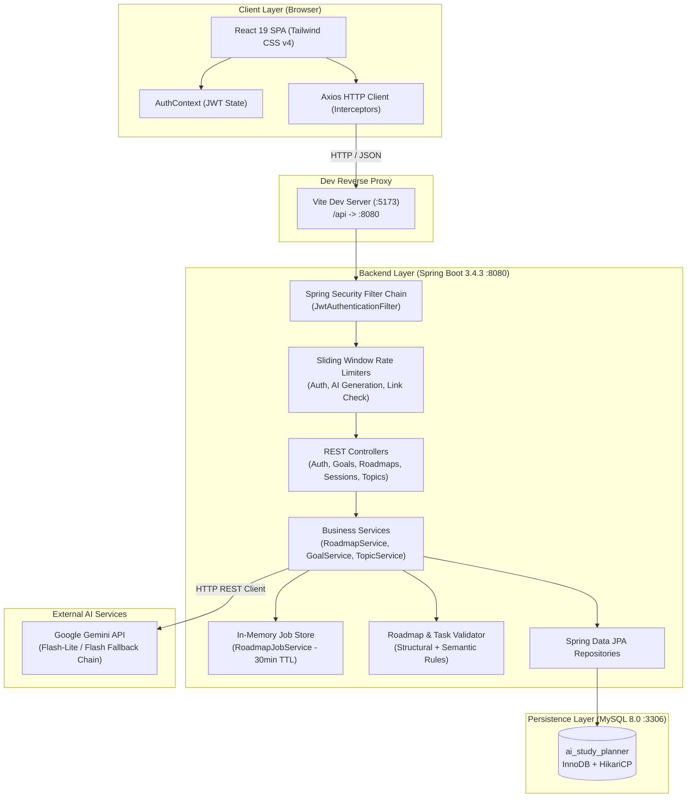
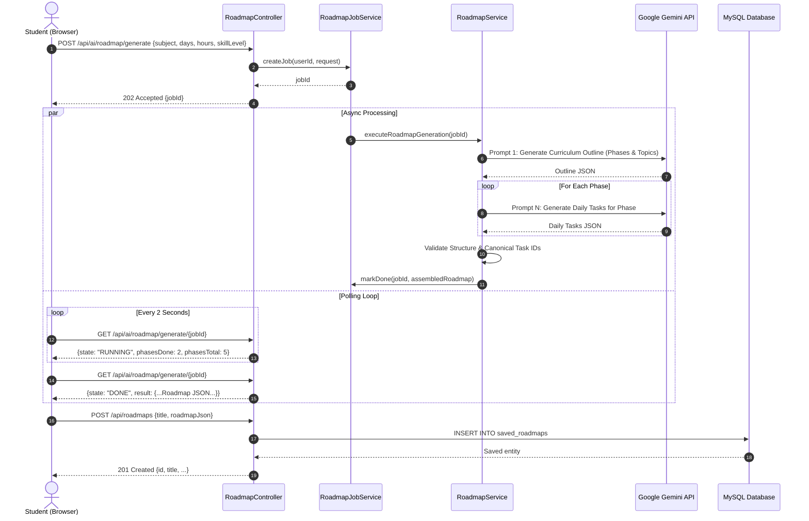

# System Architecture — AI Study Planner

This document provides a comprehensive technical overview of the **AI Study Planner** architecture, component interactions, security model, and data workflows.

---

## 1. High-Level Architecture Overview

The system is organized as a decoupled monorepo consisting of a React 19 single-page application (SPA), a Spring Boot 3.4.3 REST API backend, a MySQL 8.0 relational database, and an upstream Google Gemini AI service.



---

## 2. Frontend Architecture

### 2.1 Technology Stack
- **Framework:** React 19.3.0
- **Build Tool:** Vite 8.3.0 with `@vitejs/plugin-react`
- **Styling:** Tailwind CSS 4.3.3 via `@tailwindcss/vite`
- **Icons:** Lucide React
- **Data Visualization:** Recharts
- **HTTP Client:** Axios 1.20.0

### 2.2 Component Hierarchy & Structure
```
frontend/src/
├── components/
│   ├── auth/           # Authentication modal (Login / Register toggle)
│   ├── common/         # Navbar, Sidebar, SettingsModal, ErrorBoundary
│   ├── dashboard/      # StudentDashboard metrics, StudentPortalLanding
│   ├── goals/          # CreateGoalModal and goal management cards
│   ├── profile/        # LearningPreferencesSection, TopicsKnowledgeSection, ProfileView
│   ├── roadmap/        # InteractiveRoadmap, DayTimeline, DayDetail, PhaseList, SafeMarkdown
│   ├── ui/             # Reusable UI primitives (Button, Card, ConfirmDialog, ProgressBar, StatusText)
│   └── views/          # Top-level view routers (StudyPlannerView, ActiveStudyView, ProgressView)
├── context/
│   └── AuthContext.jsx # Global user authentication state and session hydration
├── services/
│   └── api.js          # Configured Axios instance with JWT injection & 401 handler
└── utils/              # Formatters, goal statistics calculations, study queue helpers
```

### 2.3 Authentication State Lifecycle
1. User submits credentials via `AuthModal.jsx`.
2. `AuthContext.jsx` invokes `/api/auth/login` or `/api/auth/register`.
3. The returned JWT token and user profile are saved to browser `localStorage`.
4. Axios request interceptor attaches `Authorization: Bearer <token>` to all subsequent requests.
5. Axios response interceptor intercepts `401 Unauthorized` responses, clears stored credentials, and dispatches an event to return the application to the unauthenticated state.

---

## 3. Backend Architecture

### 3.1 Technology Stack
- **Language:** Java 24
- **Framework:** Spring Boot 3.4.3
- **Security:** Spring Security 6.4 + JJWT 0.12.6
- **Persistence:** Spring Data JPA + Hibernate ORM 6.6
- **Connection Pool:** HikariCP
- **Database Driver:** MySQL Connector/J

### 3.2 Layered Architecture
```
backend/src/main/java/com/aistudyplanner/
├── config/        # SecurityConfig, WebConfig (CORS origin mapping)
├── controller/    # 13 REST Controllers mapping HTTP requests to service methods
├── dto/           # Strongly typed Request/Response transfer objects
├── entity/        # JPA Entities with table mapping, relationships, and validation constraints
├── exception/     # GlobalExceptionHandler returning RFC 7807 ProblemDetails
├── repository/    # 10 Spring Data JPA repository interfaces
├── security/      # JwtUtil, JwtAuthenticationFilter, CustomUserDetailsService, RateLimiters
└── service/       # Business logic, AI pipeline, validation, and progress tracking
```

### 3.3 Security & Multi-Tenancy (Student Isolation)
The application enforces strict student data isolation:
- Authentication is entirely stateless using HMAC-SHA512 signed JWTs.
- `JwtAuthenticationFilter` validates the token on every protected route and populates the `SecurityContext`.
- Controllers extract the authenticated student's identity exclusively from the `UserPrincipal`.
- Repository queries strictly enforce ownership:
  - `findByIdAndUserId(id, user.getId())`
  - `findAllByUserIdOrderByCreatedAtDesc(user.getId())`
- Cross-user data mutation or inspection attempts immediately return `403 Forbidden` or `404 Not Found`.

---

## 4. AI Curriculum Roadmap Generation Pipeline

The roadmap generation engine synthesizes structured study schedules using Google Gemini models with automatic multi-model fallback.

### 4.1 Asynchronous Job Execution Sequence



### 4.2 Resiliency & Fault Tolerance
- **Model Fallback Chain:** `gemini-3.5-flash-lite` -> `gemini-2.5-flash` -> `gemini-flash-lite-latest`.
- **Per-Phase Regeneration:** If one phase produces malformed JSON or schema violations, only that phase is retried.
- **In-Memory Job Store:** Generation jobs run on a dedicated thread pool with an automatic 30-minute time-to-live (TTL) eviction policy.
- **Rate Limiting:** Users are restricted to 5 generation requests per hour via a sliding window rate limiter.

---

## 5. Security Architecture

| Security Domain | Mechanism | Implementation |
|---|---|---|
| **Authentication** | JSON Web Tokens (JJWT) | HMAC-SHA512 signed with `${JWT_SECRET}` (minimum 256-bit requirement) |
| **Password Storage** | BCrypt Hashing | Cost factor 10, salted automatically |
| **Endpoint Protection** | Spring Security 6 | Stateless session management (`SessionCreationPolicy.STATELESS`) |
| **CORS Policy** | WebMvc Configuration | Restricts origin to `${CORS_ALLOWED_ORIGINS}` (default: `http://localhost:5173`) |
| **Brute-Force Defense** | Auth Rate Limiting | Max 5 failed login attempts per 15 minutes per IP + email |
| **SSRF Prevention** | Link Checker Allowlist | Restricts verified resource URLs to trusted developer and academic domains |
| **Error Sanitization** | Spring Error Config | Stack traces, exception names, and internal messages are omitted in API responses |

