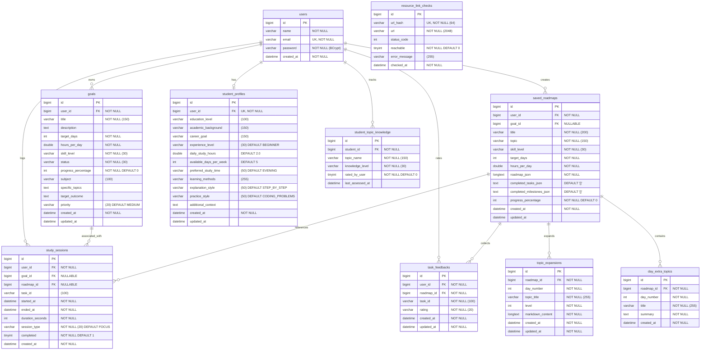

# Database Schema & Entity Documentation — AI Study Planner

This document provides the complete database architecture, entity relationships, constraints, and migration reference for the **AI Study Planner** relational database (`MySQL 8.0`).

---

## 1. Entity-Relationship Diagram (Mermaid ERD)

---

## 2. Table Specifications

### 2.1 `users`
Stores student accounts and authentication credentials.

| Column | Type | Constraints | Description |
|---|---|---|---|
| `id` | `BIGINT` | `PK, AUTO_INCREMENT` | Unique identifier for each student |
| `name` | `VARCHAR(255)` | `NOT NULL` | Student display name |
| `email` | `VARCHAR(255)` | `NOT NULL, UNIQUE` | Login email address |
| `password` | `VARCHAR(255)` | `NOT NULL` | BCrypt-hashed password |
| `created_at` | `DATETIME` | `NOT NULL` | Registration timestamp |

### 2.2 `goals`
Learning milestones and targets set by students.

| Column | Type | Constraints | Description |
|---|---|---|---|
| `id` | `BIGINT` | `PK, AUTO_INCREMENT` | Unique goal ID |
| `user_id` | `BIGINT` | `FK -> users(id), NOT NULL` | Owner student reference |
| `title` | `VARCHAR(150)` | `NOT NULL` | Goal title (e.g., "Master Docker") |
| `description` | `TEXT` | `NULLABLE` | Optional detailed syllabus or notes |
| `target_days` | `INT` | `NOT NULL` | Planned duration (1–365) |
| `hours_per_day` | `DOUBLE` | `NOT NULL` | Daily study time commitment |
| `skillLevel` | `VARCHAR(30)` | `NOT NULL` | `BEGINNER`, `INTERMEDIATE`, `ADVANCED` |
| `status` | `VARCHAR(30)` | `NOT NULL` | `NOT_STARTED`, `IN_PROGRESS`, `COMPLETED`, `ARCHIVED` |
| `progress_percentage`| `INT` | `NOT NULL DEFAULT 0` | Completion progress (0–100) |
| `priority` | `VARCHAR(20)` | `DEFAULT 'MEDIUM'` | Goal priority (`LOW`, `MEDIUM`, `HIGH`) |
| `created_at` | `DATETIME` | `NOT NULL` | Creation timestamp |
| `updated_at` | `DATETIME` | `NULLABLE` | Last modification timestamp |

### 2.3 `saved_roadmaps`
Persists synthesized curriculum structures with user progress.

| Column | Type | Constraints | Description |
|---|---|---|---|
| `id` | `BIGINT` | `PK, AUTO_INCREMENT` | Unique roadmap ID |
| `user_id` | `BIGINT` | `FK -> users(id), NOT NULL` | Owner student reference |
| `goal_id` | `BIGINT` | `NULLABLE` | Optional associated goal ID |
| `title` | `VARCHAR(200)` | `NOT NULL` | Curriculum title |
| `topic` | `VARCHAR(150)` | `NOT NULL` | Core subject/skill |
| `skill_level` | `VARCHAR(30)` | `NOT NULL` | Skill level target |
| `target_days` | `INT` | `NOT NULL` | Total planned schedule days |
| `hours_per_day` | `DOUBLE` | `NOT NULL` | Estimated daily hours |
| `roadmap_json` | `LONGTEXT` | `NOT NULL` | Full structured roadmap JSON payload |
| `completed_tasks_json` | `TEXT` | `DEFAULT '[]'` | Canonical task IDs marked as completed |
| `completed_milestones_json` | `TEXT` | `DEFAULT '[]'` | Completed milestones list |
| `progress_percentage`| `INT` | `NOT NULL DEFAULT 0` | Calculated overall completion % |
| `created_at` | `DATETIME` | `NOT NULL` | Creation timestamp |
| `updated_at` | `DATETIME` | `NULLABLE` | Progress update timestamp |

### 2.4 `student_profiles`
Personalization preferences used to tune AI generation parameters.

| Column | Type | Constraints | Description |
|---|---|---|---|
| `id` | `BIGINT` | `PK, AUTO_INCREMENT` | Unique profile ID |
| `user_id` | `BIGINT` | `FK -> users(id), NOT NULL, UNIQUE` | 1-to-1 owner relationship |
| `education_level` | `VARCHAR(100)` | `NULLABLE` | E.g. Undergraduate, High School |
| `academic_background` | `VARCHAR(150)` | `NULLABLE` | Major or degree program |
| `career_goal` | `VARCHAR(150)` | `NULLABLE` | Target role or industry |
| `experience_level` | `VARCHAR(30)` | `DEFAULT 'BEGINNER'` | Overall programming/study experience |
| `daily_study_hours` | `DOUBLE` | `DEFAULT 2.0` | Default available hours |
| `available_days_per_week` | `INT` | `DEFAULT 5` | Number of active study days per week |
| `preferred_study_time` | `VARCHAR(50)` | `DEFAULT 'EVENING'` | `MORNING`, `AFTERNOON`, `EVENING`, `NIGHT` |
| `learning_methods` | `VARCHAR(255)` | `DEFAULT 'VIDEO,CODING_PRACTICE'` | Comma-delimited preferred modalities |
| `explanation_style` | `VARCHAR(50)` | `DEFAULT 'STEP_BY_STEP'` | Explanation granularity preference |
| `practice_style` | `VARCHAR(50)` | `DEFAULT 'CODING_PROBLEMS'` | Practice exercise preference |
| `additional_context` | `TEXT` | `NULLABLE` | Custom instructions for the AI prompt |

### 2.5 `student_topic_knowledge`
Tracks student competency per topic to prevent redundant AI lessons.

| Column | Type | Constraints | Description |
|---|---|---|---|
| `id` | `BIGINT` | `PK, AUTO_INCREMENT` | Unique record ID |
| `student_id` | `BIGINT` | `FK -> users(id), NOT NULL` | Student reference |
| `topic_name` | `VARCHAR(150)` | `NOT NULL` | Topic identifier |
| `knowledge_level` | `VARCHAR(30)` | `NOT NULL` | `NOT_LEARNED`, `BEGINNER`, `INTERMEDIATE`, `MASTERED` |
| `rated_by_user` | `BOOLEAN` | `NOT NULL DEFAULT FALSE` | Flag indicating explicit user rating |
| `last_assessed_at` | `DATETIME` | `NULLABLE` | Timestamp of last level change |

**Unique Constraint:** `(student_id, topic_name)` ensures one rating record per topic per student.

### 2.6 `study_sessions`
Live focus sessions and Pomodoro recordings.

| Column | Type | Constraints | Description |
|---|---|---|---|
| `id` | `BIGINT` | `PK, AUTO_INCREMENT` | Unique session ID |
| `user_id` | `BIGINT` | `FK -> users(id), NOT NULL` | Student reference |
| `goal_id` | `BIGINT` | `NULLABLE` | Associated goal ID |
| `roadmap_id` | `BIGINT` | `NULLABLE` | Associated roadmap ID |
| `task_id` | `VARCHAR(100)` | `NULLABLE` | Canonical task identifier |
| `started_at` | `DATETIME` | `NOT NULL` | Session start time |
| `ended_at` | `DATETIME` | `NOT NULL` | Session end time |
| `duration_seconds` | `INT` | `NOT NULL` | Total active focus duration in seconds |
| `session_type` | `VARCHAR(20)` | `NOT NULL DEFAULT 'FOCUS'` | `FOCUS`, `REVIEW`, `EXAM_PREP` |
| `completed` | `BOOLEAN` | `NOT NULL DEFAULT TRUE` | Completion flag |

**Index:** `idx_user_started (user_id, started_at)` optimizes timeline queries and dashboard streak calculations.

### 2.7 `task_feedbacks`
Student feedback on generated daily tasks (too easy, too hard, just right).

| Column | Type | Constraints | Description |
|---|---|---|---|
| `id` | `BIGINT` | `PK, AUTO_INCREMENT` | Unique feedback ID |
| `user_id` | `BIGINT` | `FK -> users(id), NOT NULL` | Student reference |
| `roadmap_id` | `BIGINT` | `FK -> saved_roadmaps(id), NOT NULL` | Target roadmap reference |
| `task_id` | `VARCHAR(100)` | `NOT NULL` | Canonical task identifier |
| `rating` | `VARCHAR(20)` | `NOT NULL` | `TOO_EASY`, `JUST_RIGHT`, `TOO_HARD` |
| `created_at` | `DATETIME` | `NOT NULL` | Submission timestamp |

**Unique Constraint:** `(user_id, roadmap_id, task_id)` enforces one rating per task per user.

### 2.8 `topic_expansions`
On-demand detailed learning content generated for specific day topics.

| Column | Type | Constraints | Description |
|---|---|---|---|
| `id` | `BIGINT` | `PK, AUTO_INCREMENT` | Unique expansion ID |
| `roadmap_id` | `BIGINT` | `FK -> saved_roadmaps(id), NOT NULL` | Associated roadmap |
| `day_number` | `INT` | `NOT NULL` | Roadmap day number |
| `topic_title` | `VARCHAR(255)` | `NOT NULL` | Topic name |
| `level` | `INT` | `NOT NULL` | Expansion depth level (1, 2, ...) |
| `markdown_content` | `LONGTEXT` | `NOT NULL` | AI-generated tutorial content in Markdown |
| `created_at` | `DATETIME` | `NOT NULL` | Creation timestamp |

**Unique Constraint:** `(roadmap_id, day_number, topic_title, level)`.

### 2.9 `day_extra_topics`
Supplementary topics added to an existing schedule day.

| Column | Type | Constraints | Description |
|---|---|---|---|
| `id` | `BIGINT` | `PK, AUTO_INCREMENT` | Unique ID |
| `roadmap_id` | `BIGINT` | `FK -> saved_roadmaps(id), NOT NULL` | Associated roadmap |
| `day_number` | `INT` | `NOT NULL` | Roadmap day number |
| `title` | `VARCHAR(255)` | `NOT NULL` | Topic title |
| `summary` | `TEXT` | `NOT NULL` | Short summary and key takeaways |
| `created_at` | `DATETIME` | `NOT NULL` | Creation timestamp |

### 2.10 `resource_link_checks`
Global cache for external documentation URL verification.

| Column | Type | Constraints | Description |
|---|---|---|---|
| `id` | `BIGINT` | `PK, AUTO_INCREMENT` | Unique ID |
| `url_hash` | `VARCHAR(64)` | `NOT NULL, UNIQUE` | SHA-256 hash of checked URL |
| `url` | `VARCHAR(2048)` | `NOT NULL` | Target documentation URL |
| `status_code` | `INT` | `NULLABLE` | HTTP response code (e.g. 200, 404) |
| `reachable` | `BOOLEAN` | `NOT NULL DEFAULT FALSE` | Reachability status |
| `error_message` | `VARCHAR(255)` | `NULLABLE` | Error diagnostics if unreachable |
| `checked_at` | `DATETIME` | `NOT NULL` | Verification timestamp |

---

## 3. Database Initialization & Migration Strategy

1. **Local Development & Automated Tests:**
   - Spring Boot runs with `spring.jpa.hibernate.ddl-auto=update`.
   - New entities and schema modifications are automatically applied upon startup.
   - Tests run strictly against isolated database `ai_study_planner_test`.

2. **Production Deployments:**
   - Numbered, idempotent SQL scripts in `scripts/` provide manual migration paths:
     - `scripts/05_create_task_feedback.sql`
     - `scripts/06_create_resource_link_checks.sql`
     - `scripts/07_create_topic_expansions.sql`
     - `scripts/08_create_day_extra_topics.sql`
     - `scripts/create_study_sessions.sql`
     - `scripts/add_rated_by_user_to_topic_knowledge.sql`
     - `scripts/add_study_sessions_foreign_keys.sql`
     - `scripts/backfill_roadmap_goals.sql`

